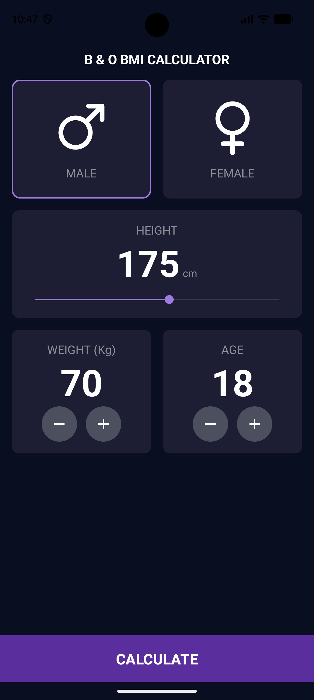
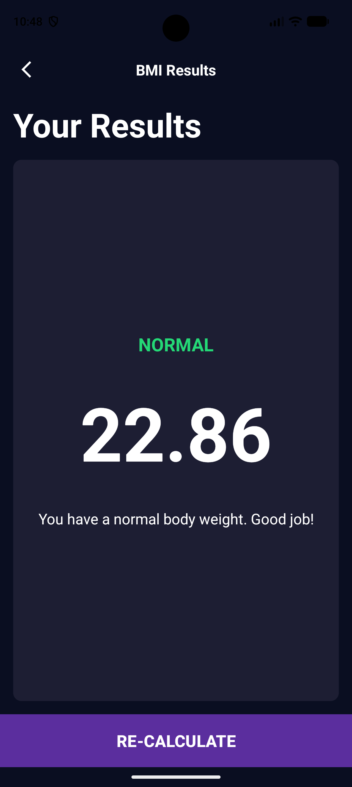

# Calculadora IMC

Aplicación Android que calcula el **Índice de Masa Corporal (IMC)** a partir de la altura y el peso, y muestra el resultado con su categoría.

Proyecto realizado para la **Activitat 03 – Android Studio** del ciclo de Desarrollo de Aplicaciones Multiplataforma (DAM) en el Institut TIC de Barcelona.

## Capturas

| Pantalla principal | Resultados |
|:---:|:---:|
|  |  |

## Funcionalidades

- Selección de sexo (masculino / femenino)
- Altura en centímetros con barra deslizante (120–220 cm)
- Peso en kilogramos y edad con botones de sumar y restar
- Cálculo del IMC y navegación a la pantalla de resultados
- Clasificación en tres categorías con color: bajo peso, normal y sobrepeso

## Tecnologías

- **Lenguaje:** Kotlin
- **Interfaz:** layouts XML (`ConstraintLayout` y `LinearLayout`)
- **Navegación:** Intents explícitos con paso de datos mediante *extras*
- **Recursos:** vector assets, drawables (`shape` y `selector`), strings y colores

## Estructura

| Archivo | Descripción |
|---|---|
| `MainActivity.kt` | Pantalla principal: gestiona los controles y calcula el IMC |
| `ResultActivity.kt` | Pantalla de resultados: recibe el IMC y muestra la categoría |
| `activity_main.xml` | Layout de la pantalla principal |
| `activity_result.xml` | Layout de la pantalla de resultados |

## Accesibilidad

- Textos en `sp` para respetar el tamaño de letra del sistema
- `contentDescription` en los botones que solo tienen icono
- Botones con un tamaño táctil mínimo de 48 dp
- Colores con contraste suficiente según las pautas WCAG
- Los números se anuncian al cambiar (`accessibilityLiveRegion`)
- La categoría del resultado no depende solo del color: también se indica con texto

## Cómo ejecutarlo

1. Clona el repositorio:
   git clone https://github.com/Ferarias-04/IMC_APP.git
2. Ábrelo con Android Studio y espera a que termine el Gradle Sync.
3. Ejecútalo en un emulador o dispositivo con Android 7.0 (API 24) o superior.

## Autor

**Fer Arias** – [@Ferarias-04](https://github.com/Ferarias-04)